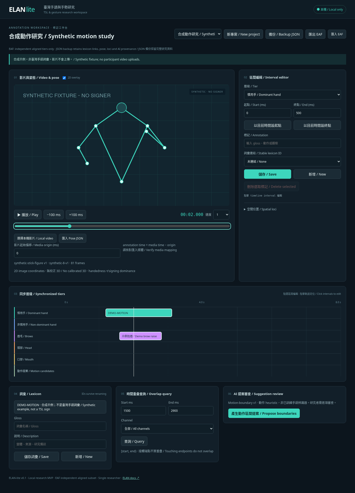

# ELAN-lite · 臺灣手語與手勢研究工作台

A local research MVP for Taiwanese Sign Language (TSL) and gesture annotation. Traditional Chinese / English interface, synchronized interval tiers, stable lexicon links, SQLite persistence, 2D pose/loci, and human-reviewed motion proposals. It is an approachable companion to [ELAN](https://archive.mpi.nl/tla/elan), not a full replacement. ELAN already supports hierarchical tiers, controlled vocabularies, reference annotations and lexicon workflows.

**合成資料示範，沒有真實參與者影片，也沒有手語辨識準確率主張。** The bundled motion and labels are synthetic; they do not represent TSL signs. The boundary proposer is a deterministic heuristic, not a trained sign recognizer.



## Install & run / 安裝與啟動

Requirements: Python **3.12+**, Node **22.12+**, npm, and a modern browser with MP4/H.264 support.

```bash
git clone https://github.com/lopentu/elan-lite.git
cd elan-lite
npm ci
npm run build
python -m backend.server
```

Open **http://127.0.0.1:8765**. Python uses only its standard library; no pip dependencies are needed to run the application. The server binds to loopback, enforces loopback Host / same-origin writes and does not upload media or invoke a cloud model. Do not expose it with a public tunnel or reverse proxy. This is a single-researcher local application, without authentication or multi-user conflict resolution.

Alternative port / database:

```bash
python -m backend.server --port 8765 --db data/my-study.sqlite
```

For frontend development, keep the Python service running and run `npm run dev` in a second terminal. Vite proxies `/api` to the loopback Python service. The production build uses one origin.

## Research workflow / 研究流程

1. Try the eight-second synthetic demo. Seek, play, click a colored interval and edit its integer millisecond boundaries or text. Each Save commits to SQLite.
2. Create a **New project** with a name and duration in milliseconds, then choose **Local video**. Templates include dominant / non-dominant hand, brows, head, mouth and a motion-candidate tier. Dominance is researcher-assigned; detector handedness is a separate concept.
3. Mark Start / End with the current playhead, link a stable lexicon ID, then Save. Same-tier overlaps are blocked. Cross-tier overlaps are allowed. Keys: Space play/pause, ← / → 100 ms, I / O mark endpoints, when focus is outside inputs.
4. Rename a lexicon entry in the Lexicon panel. Existing annotations still point to its ID and show its new gloss; their recorded annotation text remains intact.
5. Run a half-open `[start, end)` overlap query, optionally selecting a channel. Touching endpoints do not overlap.
6. Import a structured Pose JSON, inspect synchronization and missing detections, and record a 2D spatial locus on a selected annotation. Loci display during that annotation's interval. For video mapping, `annotation_ms = media_ms − media_origin_ms`; verify the Media origin control. It defaults to the first imported EAF descriptor's TIME_ORIGIN. Manual changes are session-only.
7. Generate motion-boundary proposals, inspect provenance, then Accept or Reject each item. Accept creates a separate annotation in the motion tier; edit it normally afterward. Undo review removes the accepted annotation (including subsequent edits) and returns the proposal to pending. Rejected candidates remain visible and are not regenerated as fresh candidates.
8. Export EAF for supported tier interoperability and **JSON backup** for lexicon links, pose, loci and proposal provenance. For complete restoration, stop the server and copy `data/elan-lite.sqlite`; restart with `--db` pointing at that copy. JSON is a portable inspectable snapshot; automated JSON restore is future work.

Participant media is selected via a browser object URL and **never sent to the server**. Reselect media after reload / project switching. Synthetic overlays are hidden when a real local file is chosen. The server stores annotations, lexicon, imported pose and EAF metadata; protect those sensitive derivatives too. The project duration is fixed after creation; create the project with the full video duration. Imported EAF duration is inferred from annotations (minimum 8 seconds), not from media. Avoid annotating beyond it.

## Tests / 驗證

```bash
npm test                         # Python data, EAF, adapter and HTTP tests
npm run build                    # strict TypeScript + production bundle
npx playwright install chromium  # browser installation, once
npm run test:ui                   # actual Chromium workflows + desktop/mobile checks
```

If Chromium is already installed: `CHROMIUM_PATH=/usr/bin/chromium npm run test:ui`. Tests use isolated temporary SQLite files. Optional official XSD validation requires `lxml` and a locally downloaded [EAFv3.0.xsd](https://www.mpi.nl/tools/elan/EAFv3.0.xsd):

```bash
python tests/validate_xsd.py /path/to/EAFv3.0.xsd
```

See [validation evidence](docs/VALIDATION.md), [architecture / schema](docs/ARCHITECTURE.md), [EAF compatibility contract](docs/EAF.md), [pose / AI research caveats](docs/AI.md), and [roadmap](docs/ROADMAP.md).

## Current scope / 現階段限制

- Independent aligned EAF tiers only; unsupported graph structures are rejected with a report before database writes. Full EAF features are documented, never silently flattened.
- Single researcher / one local process. No collaboration, accounts, role permissions, immutable audit log, full edit undo or migration framework.
- Video and pose must already exist locally. No trained TSL recognition, automatic participant pose extraction, cloud inference, accuracy estimates or corpus evaluation.
- Pose is normalized image-plane **2D**; inferred model world coordinates are not calibrated 3D. Motion/hold heuristics are not linguistic segmentation.
- No waveform, frame-accurate decoding guarantee, timeline zoom, arbitrary tier authoring or multi-camera synchronization. Numeric interval editing remains available on long clips. Codec support depends on the browser.
- EAF desktop reopen has not been performed. Official schema validation and supported-subset round-trips passed; use ELAN's own Validate EAF File command before corpus use.

Original repository MIT license preserved. Project assets are synthetic and generated for this MVP.
